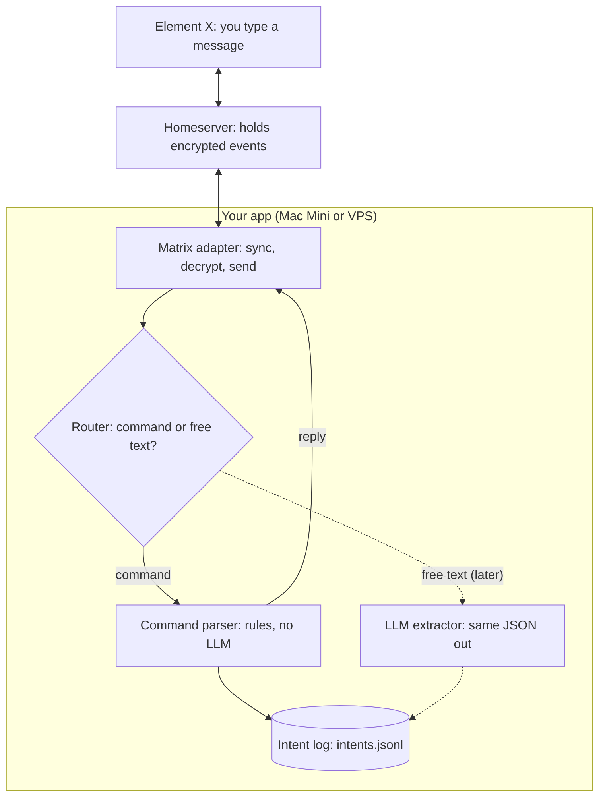
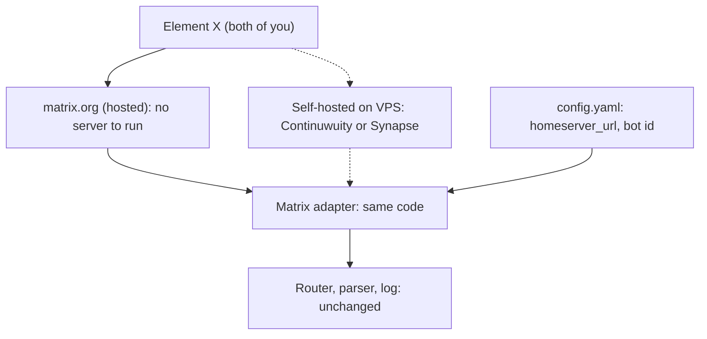
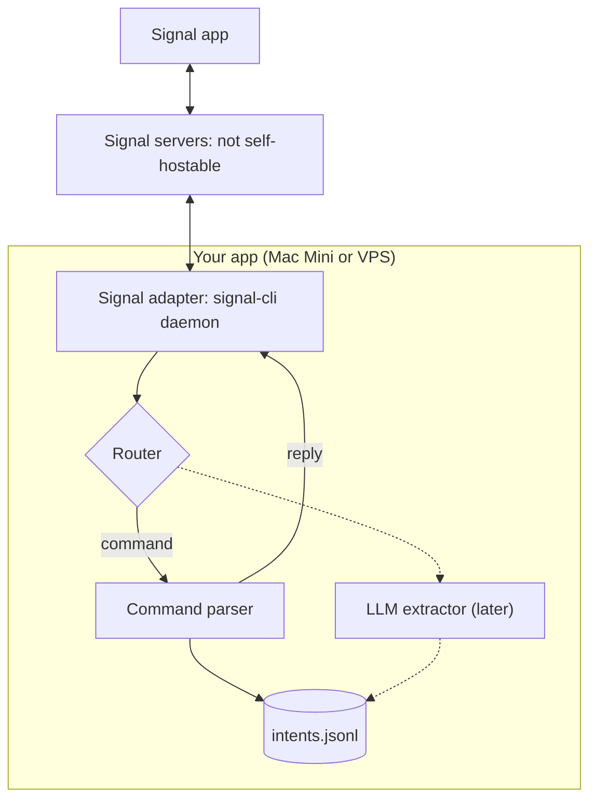

# Bot architecture and v0 plan

Copied from the Notion page [Bot architecture and v0 plan](https://app.notion.com/p/40fdf9b316d6819bab45f30ad79de24c), under the project Life Admin Assist.

> State as of 2026-11-05. Text only (no voice), no calendar or to-do yet. v0 = small app that reads and writes messages, parses commands with rules and logs JSON intents. LLM comes later.

## 1. Architecture: ports and adapters

The core never imports a messenger library. Each messenger gets an adapter that turns its messages into one normalized shape. Switching messenger = writing a new adapter plus mapping platform user IDs to internal user IDs.

```py
@dataclass
class Incoming:
    channel: str            # "matrix", "signal", ...
    conversation_id: str    # Matrix room, Signal chat or group, ...
    user: str               # internal id, e.g. user_a
    text: str | None
    attachments: list[Attachment]

class Messenger(Protocol):
    async def start(self, on_message): ...
    async def send(self, conversation_id: str, text: str, reply_to: str | None = None): ...
```

- Cheap: one Python process, adapter is a class. Fine for v1.
- Robust (preferred, since the messenger may change): adapter as its own small service, talking to the core over localhost HTTP.
- Keep the core to plain text plus attachments. Reactions, edits and threads stay inside the adapter.

## 2. v0 flow with Matrix

Diagram type: data flow diagram (close to a C4 container diagram). Dashed = later.



## 3. Homeserver: matrix.org or self-hosted



The code switches with one config change. The accounts do not:

- Matrix IDs include the server (@bot:matrix.org vs @bot:yourserver). Switching = new accounts for both of you and the bot, new rooms, new crypto store. Old chat history stays on the old server. The JSONL log is yours and survives.
- Federation allows a mix: you two stay on matrix.org, the bot lives on your server (federation must stay on).
- matrix.org: zero ops, free. Messages are E2E encrypted, but metadata (who talks to whom, when, room membership) sits on their server.
- Self-hosted: you control metadata and can turn federation off. Cost: a VPS, updates, backups. Check Element X compatibility (sliding sync) before picking a lightweight server (unverified).
- Recommendation: start on matrix.org, keep homeserver_url in config, move once the bot is worth keeping.

## 4. Same flow with another messenger (example: Signal)

Only the messenger, its servers and the adapter change. Router, parser, log and LLM extractor stay identical.



|  | Bot identity | Adapter library | Shared space | Encryption to the bot |
| --- | --- | --- | --- | --- |
| Matrix | Free bot account | mautrix-go | Room | E2EE, bot device must be cross-signed |
| Signal | Own phone number needed | signal-cli (unofficial, Java) | Group | E2EE via signal-cli |
| Telegram | BotFather, official | Bot API | Group | Not E2E: server sees bot messages |
| Threema | Gateway ID (paid) | Threema Gateway SDK, E2E mode | Group (gateway limits unverified) | E2EE |

## 5. Intent format: JSONL

One JSON object per line, appended. Readable, diffable, no database needed yet. Move to SQLite once the bot must answer queries like "what's on today".

```json
{"id":"01JC...","ts":"2026-11-05T14:02:11+01:00","user":"user_a","conversation_id":"!abc:server","raw":"cal: tue 10:00 Zahnarzt","source":"command","action":"add_event","payload":{"title":"Zahnarzt","start":"2026-11-10T10:00:00+01:00"},"status":"logged"}
```

- The schema is the contract (Pydantic model, action in add_event, add_todo, unknown). The LLM later fills the same model.
- Log unparsed messages as action unknown with the raw text: real test set for the LLM later.
- Reply echoes what was parsed, e.g. "Logged: add_event, Zahnarzt, Tue 10 Nov 10:00".
- Calendar and to-do come later as an executor: reads status logged, writes, sets done. Old intents can be replayed.
- v0 syntax: `todo: <text>` and `cal: <day> <time> <title>`, dates via dateparser. Everything else becomes unknown.

## 6. Does the bot need an LLM?

Not for v0. Hybrid later:

1. Exact commands go to code, no LLM.
2. Everything else goes to the LLM, which only returns structured JSON.
3. Code validates and executes; the model never touches the calendar.
4. Deletes and ambiguous cases need a confirmation.

Extraction is a narrow task, so a small local model via Ollama may be enough and keeps everything private (test on own messages first). Main LLM risk: wrong date or wrong list (personal vs shared), hence the echo plus one-tap undo.

## 7. Matrix checklist

- Dedicated bot account; log in with password once to get its own device (an Element token can't be reused).
- Persistent crypto store (SQLite) and access token; back them up.
- Cross-signing: bot bootstraps it and self-signs its device with a recovery key. Element announced that unverified devices can no longer send or receive E2EE messages (April 2026, pushed to Oct 2026; rollout not confirmed).
- Sync loop: long-poll /sync, save since token, ignore own messages, skip backlog on first start.
- Rooms: one DM per person plus one shared room.
- Allowlist: auto-join invites only from the two user IDs.
- No inbound ports needed: the bot connects outbound.

## 8. Stack

| Layer | Pick | Note |
| --- | --- | --- |
| Matrix adapter | Go + mautrix-go | Recovery key self-signing helper; single static binary |
| Alternative | Python + mautrix-python | Last release found: Jan 2025, maintenance risk |
| Avoid | matrix-nio | nio-bot framework archived Apr 2026 |
| Core | Python, asyncio/FastAPI, JSONL then SQLite |  |
| LLM (later) | Claude Haiku or Ollama, structured output |  |
| Deploy | Docker Compose | Same file on Mac Mini (OrbStack) and VPS |
| Secrets | .env chmod 600 or Keychain | Never in git |

## 9. Risks

- Biggest: E2EE friction ("unable to decrypt", unverified bot device silently ignored by Element).
- Counterargument to adapters: bridge other messengers into Matrix instead; but the bridge decrypts, so E2EE ends at your server.
- Leaky abstraction: features one messenger has and others don't.

## 10. Build order

- [ ] Bot account on matrix.org, homeserver_url in config
- [ ] Encrypted echo bot: cross-signed, survives restart, tested from Element X on iPhone
- [ ] Router and command parser
- [ ] JSONL intent log plus echo reply
- [ ] Later: LLM extractor, executor for calendar and to-do, voice, digests

## Sources

- [Element: Verifying your devices is becoming mandatory](https://element.io/blog/verifying-your-devices-is-becoming-mandatory-2/)
- [matrix.org: Exclude insecure devices is coming](https://matrix.org/blog/2025/11/exclude-insecure-devices/)
- [maubot encryption docs](https://git.sudo.is/matrix/mautrix-docs/src/branch/android-sms-qr/maubot/usage/encryption.md)
- [mautrix (PyPI) release history](https://data.safetycli.com/packages/pypi/mautrix/)
- [nio-bot (archived)](https://github.com/timedoutuk/nio-bot)
