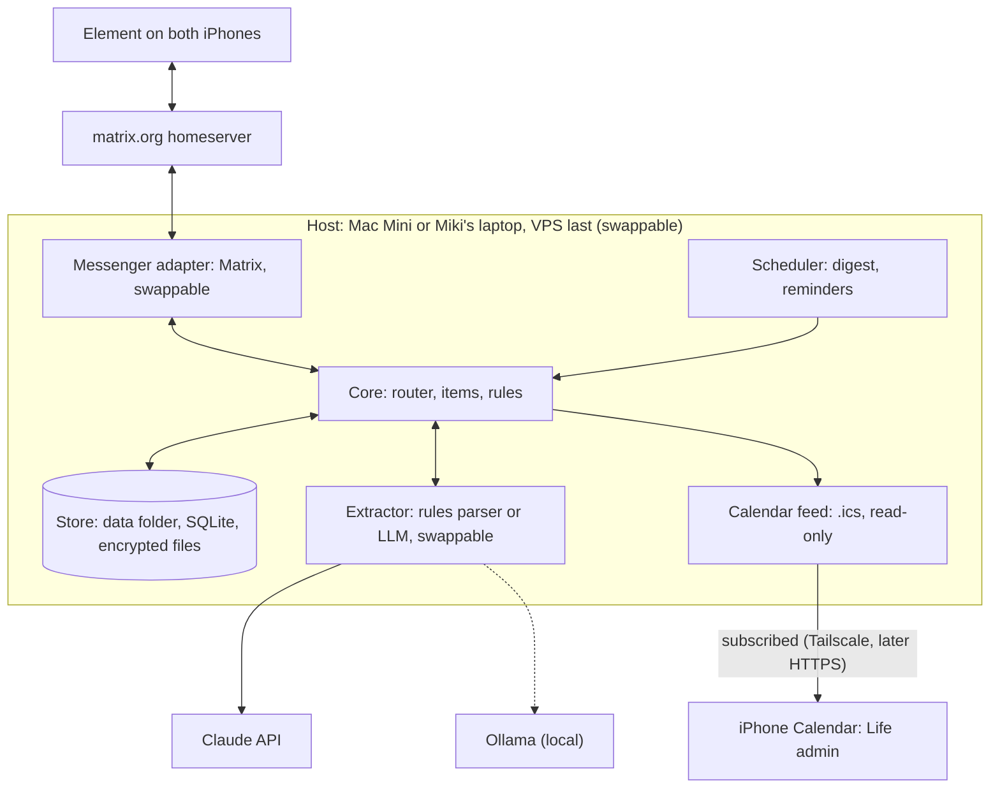

# Life Admin Assist – build plan

06/11/2026 · Luminary · version 3 (order: rules first, LLM at 10, server last at 13; host swappable between Mac Mini and Miki's laptop)
Status: increment 1 not started. Requirements: [requirements.md](requirements.md).

## Progress

- [ ] 1 Echo bot
- [ ] 2 Restart safety
- [ ] 3 Rules parser and storage
- [ ] 4 Lists and commands
- [ ] 5 Two users and sharing
- [ ] 6 Daily digest (soft launch)
- [ ] 7 Reminders and recurring
- [ ] 8 Archive and export
- [ ] 9 End-to-end encryption
- [ ] 10 LLM extractor
- [ ] 11 Calendar feed
- [ ] 12 Voice notes and screenshots
- [ ] 13 Move to a server

## Decisions this plan assumes

Change any of these before increment 1 starts; later it gets expensive.

| # | Decision | Why | Alternative |
|---|---|---|---|
| 1 | Python, with the mautrix-python library for Matrix | Matches the setup guide (uv); readable for learning | Go (mautrix-go) is more actively maintained; mautrix-python's last release found was Jan 2025 |
| 2 | Four swappable parts: chat provider, item extractor (rules parser or LLM), host machine, calendar feed | Each can change without touching the rules | Hard-wire them (faster at first, expensive to change) |
| 3 | Rules-only parser first (increment 3), LLM later (increment 10). Both fill the same slot; the parser stays as the LLM's fallback | Bot is usable early without AI cost; real messages collected meanwhile become the LLM's test set | LLM first |
| 4 | Start in an **unencrypted** Matrix room; end-to-end encryption is increment 9 | Encryption is the most common reason Matrix bots break | Encrypted from day one |
| 5 | Automated end-to-end tests run against a **local test Matrix server** (Synapse in Docker) on GitHub Actions, never matrix.org | matrix.org has rate limits; tests would be slow and flaky | Manual checks only |
| 6 | Calendar as a read-only subscription feed (.ics), reached via Tailscale until the server | One-way by design, no iCloud login stored | CalDAV into iCloud (needs an app-specific password) or self-host Radicale |
| 7 | Runs on the Mac Mini **or** Miki's laptop until the last step; a rented server (VPS) is increment 13 | Everything is built and used locally first | Server earlier |
| 8 | Only one host runs the bot at a time | Two copies on one bot account would both reply to every message | Automatic hand-over between hosts (not needed for two users) |

## End architecture



Swappable: messenger adapter, extractor, calendar feed, host. The core and the store format never change when one of them changes.

## Implementation

### One process, three loops

```
main.py (composition root)
 ├─ Matrix sync loop     receives messages, sends replies
 ├─ Scheduler loop       08:00 digest, reminders        (increment 6)
 └─ Small web server     calendar .ics feed             (increment 11)
```

All three run in one Python asyncio process. `main.py` is the only file that knows which adapters are used: it reads the config, builds the Matrix adapter, the extractor, the store and the clock, and hands them to the core. Swapping a part means changing the config (and, for a new provider, adding one adapter).

### Ports: what the core depends on

```python
# core/ports.py
class Extractor(Protocol):                 # rules parser, Claude, Ollama
    async def extract(self, text: str, today: date, user: str) -> Intent: ...

class ItemStore(Protocol):
    def add(self, item: Item) -> int: ...
    def open_items(self, user: str) -> list[Item]: ...

class Clock(Protocol):
    def now(self) -> datetime: ...

@dataclass
class Incoming:
    user: str            # internal id, e.g. "user_a", never a Matrix ID
    conversation: str
    text: str
    event_id: str        # for de-duplication

@dataclass
class Reply:
    conversation: str
    text: str
```

```python
# core/bot.py
async def handle(msg: Incoming) -> list[Reply]:
    if cmd := match_command(msg.text):          # /list, done 3, move 5 to Fri
        return cmd.run(store, clock, msg)
    intent = await extractor.extract(msg.text, clock.now().date(), msg.user)
    item = items.create(intent, msg.user, clock.now())
    return [Reply(msg.conversation, confirm_line(item))]
```

The core returns replies instead of sending them, so tests call `handle()` with a fake extractor, an in-memory store and a fixed clock, and check the replies. No network.

From increment 10, the configured extractor is the LLM wrapped with the rules parser as fallback: if the model is slow (about 8 seconds, to stay under the 10-second requirement), down, or returns invalid output twice, the rules parser handles the message instead.

### What happens to one message

1. Sync: the Matrix adapter keeps a long-poll `/sync` open to matrix.org.
2. Filter (adapter): drop the bot's own messages, non-text (until increment 12), senders not on the allowlist, edits (Element sends an edit as a new event whose body starts with `* `), and anything older than the bot's first start.
3. Dedupe: skip event IDs already in the processed table.
4. Map identity: `@name:matrix.org` becomes `user_a`, so items don't depend on the provider.
5. Core: `handle()` returns replies.
6. Send: plain text; long lists split into several messages; "typing…" shown while the extractor works.
7. Persist: save the sync position (`next_batch`) and mark the event processed.

### Matrix adapter

- Login once in `scripts/login.py`, not on every start. It saves the access token and device ID to `data/secrets/bot.json` (git-ignored, readable only by you). Logging in on every start creates a new device each time, which breaks encryption later.
- Sync filter asks only for messages and invites.
- Auto-join only invites from allowlisted users.
- On a rate-limit answer (`M_LIMIT_EXCEEDED`), wait and retry.
- matrix.org uses the new login system (MAS) since April 2025; password login still works through a compatibility layer, but such tokens may expire (unconfirmed for matrix.org). If they do, the adapter switches to device-code login (you approve the bot once via a link).
- mautrix-python handles sync, sending and later encryption. Exact call names are checked against the mautrix docs in increment 1.

### Extractor: rules parser, then LLM

- **Rules parser (increment 3)**: #tags, #us, `!`/urgent, dates in a fixed list of formats (14/11, Fri, by Friday, tomorrow, next week), "waiting for" sets Waiting on. Whatever is left becomes the title. Anything without a recognised date goes to the backlog, and the reply says so.
- **LLM adapters (increment 10)**: Claude (Anthropic SDK, structured output) and Ollama (same schema via structured output). Same prompt for both: today's date, the user's existing project tags, the Intent schema. Output validated against the Pydantic `Intent` model; one retry if invalid; then the rules parser.
- Provider is one config line: `extractor = "rules"`, `"claude:haiku"` or `"ollama:qwen2.5"`.
- Ollama needs a reasonably strong machine: fine on the Mac Mini, slow on a laptop without a GPU, not usable on a cheap VPS. On those, use the Claude API.
- With the Claude API, item text goes to Anthropic; health items stay vague as the requirements say.

### Config, secrets, logs

```toml
# config.toml (in git)
homeserver = "https://matrix-client.matrix.org"
bot_id = "@lifeadmin-bot:matrix.org"
timezone = "Europe/London"
extractor = "rules"
data_dir = "~/lifeadmin-data"

[users]
"@you:matrix.org" = "user_a"
"@husband:matrix.org" = "user_b"
```

Secrets (Matrix token, later the Anthropic API key) live in `.env` and `data/secrets/`, never in git. Logs record event IDs, intents and errors, not full message text (switchable for debugging).

### Repo layout

```
src/lifeadmin/
  core/        bot.py  commands.py  items.py  intents.py  digest.py  ports.py
  adapters/
    matrix/    client.py  mapping.py
    extract/   rules.py  claude.py  ollama.py  fake.py
    calendar/  ics_feed.py
    fake_messenger.py
  store/       sqlite.py
  main.py
deploy/        macos/ (launchd)  wsl/ (systemd)  docker/ (VPS)
scripts/       login.py  create_test_users.py  move_host.md
tests/         unit/  contract/  e2e/  evals/
CLAUDE.md      rules: tests first, core never imports adapters, no secrets in git
```

## Hosts (swappable)

The code is the same everywhere. What differs per host lives in `deploy/` and in the config.

| | Mac Mini | Miki's laptop (Windows 11 + WSL2 Ubuntu) | VPS (increment 13) |
|---|---|---|---|
| Runs the bot with | `uv run lifeadmin` | `uv run lifeadmin` inside Ubuntu | Docker |
| Keeps it running | launchd service | systemd service inside WSL2 | Docker restart policy |
| Always on? | Yes | Only while the laptop is awake; WSL2 may also stop when no window is open (to check) | Yes |
| Ollama | Usable | Slow (no GPU); use Claude API | Not usable; use Claude API |
| Calendar feed reachable via | Tailscale on the Mac | Tailscale on Windows; WSL2 networking needs checking | HTTPS (Caddy) or Tailscale |

**Moving the bot between hosts**

1. Stop the bot on the old host.
2. Copy the whole data folder (`data_dir`: SQLite file, encrypted screenshots, `secrets/`, encryption keys). Never log in again on the new host, or the bot gets a new device.
3. Start the bot on the new host.

A start-up check refuses to run if the data folder says another host is running it (a lock file with host name and last heartbeat), so two copies never answer at once.

**Laptop sleep**: if the 08:00 digest is missed because the machine was asleep, the bot sends it as soon as it wakes, marked "late", up to 12:00. After that it is skipped and logged. This also covers the Mac after a power cut. (Proposal; confirm as a requirement.)

## Accounts

| Account | When | How |
|---|---|---|
| Bot (`@lifeadmin-bot:matrix.org`) | Before increment 1 | Normal matrix.org account, created at app.element.io in a private window. Use a separate email alias if asked. Save the password and, if offered, the recovery key (needed in increment 9). Then run `scripts/login.py` once so the bot gets its own device, and sign out of the browser. |
| Yours | Before increment 1 | Normal matrix.org account in Element |
| Your husband's | Before increment 5 | Normal matrix.org account in Element |
| Test users | Automatic | Created by `scripts/create_test_users.py` on the local test server; thrown away after each run |
| Tailscale | Before increment 11 | Free personal account; app on the host and both iPhones |
| Anthropic API key | Before increment 10 | console.anthropic.com, pay as you go |
| VPS | Before increment 13 | Provider to choose |

## How we test

| Layer | What it checks | Speed | Runs |
|---|---|---|---|
| Unit | Pure rules: commands, parser, reply text, dates, intent validation | Milliseconds | Every save and push |
| Contract | The core with a fake messenger and a fake extractor: message in, reply out | Under a second | Every push |
| End-to-end | A test account sends a real message through the local test Matrix server and checks the reply | Under a minute | Every push (GitHub Actions, Linux) |
| Host | Unit and contract tests on both Linux and macOS, so the Mac Mini and the laptop (WSL2 is Linux) are both covered | Minutes | Every push (GitHub Actions matrix) |
| Evals (from increment 10) | ~30 real saved messages through the real LLM, scored against expected intents | Minutes, costs a little | By hand when the model or prompt changes |

Rules:

- Tests are written first and must fail before code is written.
- Time comes from a clock object, never read directly, so tests can set any day and time, including Fridays, weekends and UK clock changes.
- No real passwords, tokens or API keys in tests or in GitHub.
- One structure test checks that `core/` never imports from `adapters/`. If the rule breaks, the build fails.

## Working loop per increment

1. Agree: `grill-me` on the goal and edge cases. Write down what is in and out.
2. Tests: `tdd` writes the tests. You review them before any code is written (main review point).
3. Build: Claude Code writes code until all tests pass.
4. Tidy: refactor with tests still passing.
5. Try it: one manual check from Element on your phone.
6. Save: commit and push; GitHub Actions must be green.
7. Update: tick the increment off here and in `CLAUDE.md`, and note anything learned.

## Increment 1: echo bot

**Goal**: you send the bot a message in Element and it replies "Got: <your text>".

**In scope**: bot login via `scripts/login.py`; listen and reply in the same conversation; allowlist; ignore own messages, non-text, edits and old messages on first start; settings in `config.toml`, token in `data/secrets/`; project skeleton (`pyproject.toml` with uv, pytest config, GitHub Actions workflow).

**Out of scope**: parsing, storage, commands, encryption, LLM, calendar, digests, restarts.

**Tests written first**

| Layer | Test |
|---|---|
| Unit | "hello" gives "Got: hello" |
| Unit | The bot's own message, a non-allowlisted sender, a non-text message and an edit (`* ` body) each give no reply |
| Unit | A reply that quotes an earlier message is answered on its new text only |
| Contract | One allowlisted message produces exactly one reply, in the same conversation |
| Contract | Messages older than the bot's first start get no reply |
| Contract | The core runs with the fake messenger only, no Matrix library loaded |
| Contract | An expired or invalid token stops the bot with a clear "run scripts/login.py" message |
| End-to-end | Test user sends "ping"; the bot replies "Got: ping" within 10 seconds |
| End-to-end | A stranger's message gets no reply within 5 seconds |
| Structure | `core/` imports nothing from `adapters/` |

**Setup note**: Element encrypts direct messages by default and encryption can't be turned off later. For increments 1 to 8, create a **room** with encryption switched off and invite the bot.

**Done when**: all tests green on GitHub Actions and a message from your phone gets the echo back.

## Increments 2 to 13

Each row follows the same loop. Tests listed are the key ones.

| # | Increment | Key tests written first | New tooling and accounts |
|---|---|---|---|
| 2 | Restart safety | Kill and restart mid-conversation: no double replies; a message sent while the bot was down is answered after restart; sync position and processed events saved in the data folder; lock file stops a second copy | SQLite (built into Python); temporary data folder in tests |
| 3 | Rules parser and storage | `#home frame prints` gives backlog in Home; `#job review contract by Fri` gives a to-do due this Friday; `#us` sets shared; `!` sets urgent; `14/11` reads as 14 November (UK format); unknown date wording goes to backlog and the reply says so; items saved and survive a restart | Nothing new |
| 4 | Lists and commands | `/list` with 30+ items shows all, grouped and numbered; numbers stable within a day; `done 3`, `move 5 to Fri`, `urgent 5`, `backlog 12`, `schedule 3 Tue`, `drop 4`; `done router` asks when two items match; long lists split | Nothing new |
| 5 | Two users and sharing | A #us item appears for both and either can tick it off; items without #us stay private; each user gets their own replies | Your husband's Matrix account |
| 6 | Daily digest | With a test clock: 08:00 Mon–Fri only; one-liner when nothing is due; Now then projects; Friday adds numbered backlog; weekend items in Friday's digest; correct on UK clock-change days; each user gets their own digest; missed digest sent late after wake until 12:00 | APScheduler (or a small own loop); `zoneinfo`; launchd (Mac) or systemd in WSL2 (laptop) |
| 7 | Reminders and recurring | Ticking a recurring item sets the next date; waiting-on nudges after 5 days then weekly; `daily 5` override; timed reminders ("Saturday morning" = 09:00); defaults read from one settings file | `python-dateutil` for repeat rules |
| 8 | Archive and export | `/done` lists recent items; search finds old ones; export writes everything to one file and reads it back; host move procedure tested (copy data folder, start elsewhere) | Nothing new |
| 9 | End-to-end encryption | The end-to-end tests pass in an encrypted room; bot device is cross-signed with the recovery key; bot still decrypts after restart and after a host move | mautrix crypto extras; recovery key in `data/secrets/`. Risk: Python Matrix encryption relies on libolm, which Matrix is believed to have deprecated (check). This may be where switching the adapter to Go pays off; the modular design limits that to one folder |
| 10 | LLM extractor | Free text gives the same Intent format as the parser; the same contract tests pass with rules, fake, Claude and Ollama extractors; invalid output retried, then rules parser; timeout falls back within 10 s; eval set built from real messages saved since increment 6 | Pydantic; Anthropic API key and `anthropic` SDK; Ollama and a model (Mac Mini only); `tests/evals/` |
| 11 | Calendar feed | Dated items appear in the generated .ics feed; titles only; changing a due date updates the event; feed URL needs a secret token; iPhone subscription shows the events; refresh delay measured | `icalendar`; small web server (aiohttp); Tailscale on the host and both iPhones |
| 12 | Voice notes and screenshots | Sample voice note becomes an item; sample screenshot fills due date and reference; `show router` sends it back; ticking off deletes the screenshot; screenshot files encrypted on disk | Speech-to-text adapter (mlx-whisper on the Mac, an API on the laptop); ffmpeg for Element's voice format; vision through the LLM extractor; `cryptography`; sample audio and image files in tests |
| 13 | **Move to a server (last)** | Full test suite passes on the server; data folder moved with the host procedure; daily backup restores cleanly; an alert fires if a digest is missed; calendar feed reachable over HTTPS (or Tailscale) | VPS account; Docker and Compose; Caddy for HTTPS; restic for backups; healthchecks.io for missed-digest alerts; total cost checked against £5/month |

**Soft launch**: from increment 6 the bot is useful daily (add, list, tick off, digest) on the Mac Mini or the laptop. Start using it then; real messages saved from then on become the LLM eval set in increment 10. The two-week v1 test starts once all acceptance criteria pass.

## Calendar

- The bot publishes a read-only `.ics` feed at a secret address. Both iPhones subscribe once: Settings → Calendar → Accounts → Add Subscribed Calendar.
- One-way by design, matching the requirement. No iCloud login is stored.
- iPhones refresh subscribed calendars on their own schedule, so new events can take a while to appear (measured in increment 11).
- Until the server, the phones reach the feed through Tailscale; nothing is exposed to the public internet. When the host moves, the feed address changes unless it uses the Tailscale name of a fixed machine; plan the address in increment 11.
- Alternatives if the delay is a problem: write into a shared iCloud calendar via CalDAV (faster, but the bot holds an iCloud app-specific password, which opens more than the calendar), or self-host Radicale (more to run; worth it only if edits in Calendar should sync back).

## Risks

| Risk | What we do about it |
|---|---|
| mautrix-python is maintained less actively than its Go sibling | All Matrix code stays in `adapters/matrix/`, so swapping library or language touches one folder |
| matrix.org compatibility tokens may expire | Test in increment 1; device-code login as fallback |
| Element's message formats (edits, quoted replies, formatted text) | Samples of each in increment 1 tests |
| Rules parser misses many real phrasings before increment 10 | Unclear dates go to backlog with a clear reply; misses are saved and drive the LLM eval set |
| LLM misreads a date or the list (personal vs shared) | One-line confirmation on every add, eval set, rules parser as fallback |
| Element's encryption defaults block an unverified bot in encrypted rooms | Unencrypted room until increment 9; cross-signing tested explicitly |
| Laptop sleeps or WSL2 stops, so digests are missed | Late digest on wake; prefer the Mac Mini for daily use; server in increment 13 |
| Two hosts run the bot at once | Lock file check at start-up; move procedure in increment 8 |
| Scope creep | New ideas go on the v2 list, not into the current increment |

## Open questions still affecting this plan

See [requirements.md](requirements.md). The ones that block an increment:

- Before increment 6: confirm the "late digest after wake" rule.
- Before increment 10: which LLM provider first, and whether health items may go to a cloud model (question 7).
- Before increment 11: confirm the subscription feed approach after testing the iPhone refresh delay (question 6).
- Before increment 13: which VPS and the budget (questions 2 and 3).
